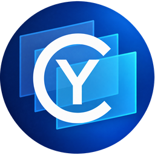
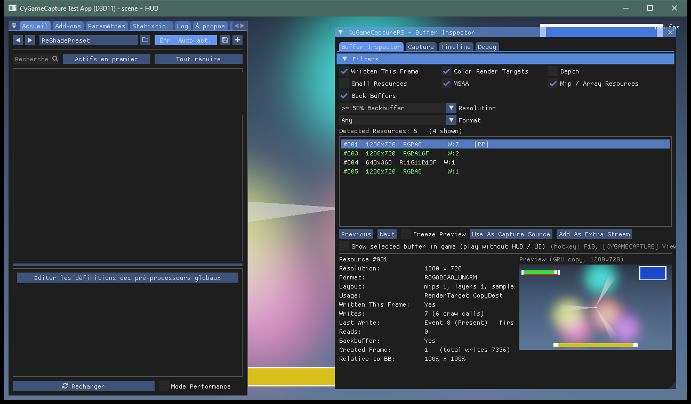
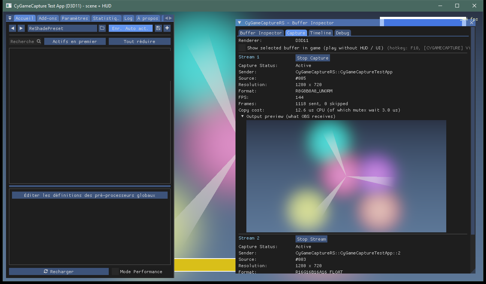
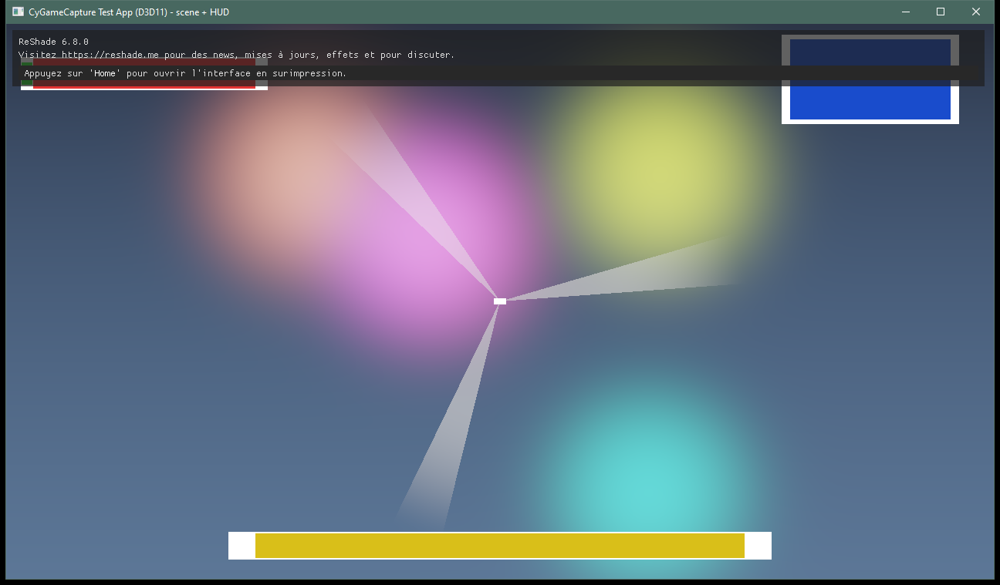
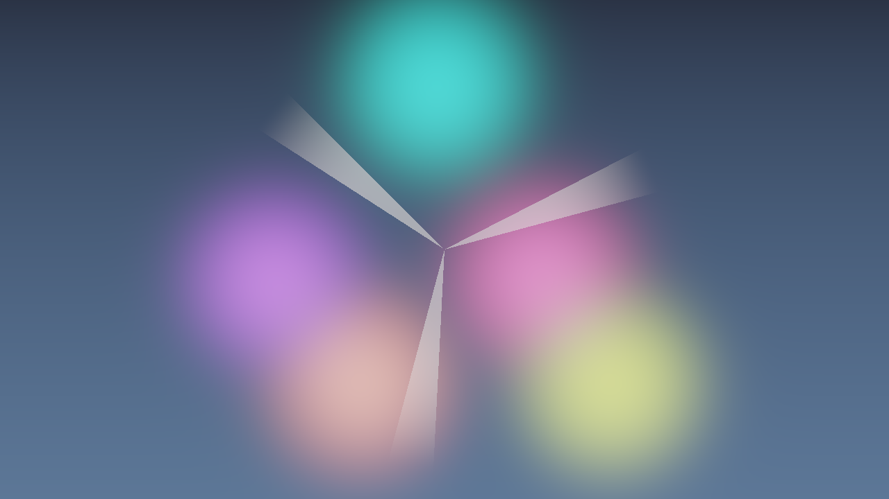

<table width="100%">
  <tr>
    <td width="300" align="left" valign="top">
      <a href="https://mrmybal.github.io/CyGameCapture/Documentation.html#/fr/overview">Documentation</a><br>
      <a href="https://github.com/MrMybal/CyGameCapture">Dépôt des sources</a><br>
      <a href="https://github.com/MrMybal/CyGameCapture/issues">Suivi des problèmes</a><br><br>
      <sub>README</sub><br>
      <a href="README.md">English</a> · <a href="README.fr.md">Français</a>
    </td>
    <td width="400" align="center" valign="middle">
      
    </td>
    <td width="300" align="right" valign="top">
      <p><sub>Licences de l’application</sub><br><a href="LICENSE"><strong>AGPL-3.0-or-later</strong></a><br><a href="CyGameCaptureUE/LICENSE">Plugin Unreal : MIT</a></p>
      <p><sub>Version</sub><br><a href="CHANGELOG.fr.md#current-version"><strong>0.1.0</strong></a><br><strong>BÊTA</strong></p>
      <p><a href="https://github.com/MrMybal/CyGameCapture/releases/download/v0.1.0/CyGameCapture-0.1.0-Complete-Win64.zip"><strong>Télécharger</strong></a><br><sub>Windows x64</sub></p>
    </td>
  </tr>
</table>

<h1 align="center">CyGameCapture</h1>
<p align="center">Par <a href="https://github.com/MrMybal">Cyberalien</a></p>

Capturez l’image qui vous intéresse dans le rendu d’un jeu et partagez-la avec OBS ou une autre application Spout2. CyGameCapture réunit un inspecteur de buffers pour ReShade, une source OBS et un plugin Unreal Engine d’émission/réception, pour les streamers et les développeurs qui travaillent avec des images de jeux.

> **BÊTA · 0.1.0**
>
> Disponible pour les essais et la validation avant une version stable. Consultez les [notes de version, correctifs et limites connues](CHANGELOG.fr.md#current-version) avant une mise à jour. Les téléchargements actuels comprennent la mise à jour documentaire publiée le 6 novembre 2026.

[](Docs/Images/m1_buffer_inspector.png)

## L’application

Conservez l’image normale du jeu, avec son HUD et ses menus, tout en envoyant une scène propre à OBS. Choisissez une cible de rendu dans le **Buffer Inspector**, vérifiez son aperçu et cliquez sur **Use As Capture Source**. Si le jeu dessine son HUD directement dans l’image finale, la capture D3D11 peut sélectionner un moment avant ce dessin.

```text
Jeu → ReShade → buffer sélectionné → texture GPU partagée → Spout2 → OBS
```

L’onglet **Capture** affiche le nom d’émetteur, la résolution, les compteurs d’images et l’aperçu de sortie de chaque flux. Ajoutez d’autres flux pour diffuser plusieurs buffers, une profondeur linéarisée ou un HUD isolé. Dans OBS, ajoutez une source **CyGameCapture** et sélectionnez l’émetteur correspondant. L’enregistrement de plusieurs flux dans des fichiers séparés est également disponible.

[](Docs/Images/m1_capture_tab_two_streams.png)

| Vue du joueur avec HUD | Scène propre reçue par Spout |
| --- | --- |
| [](Docs/Images/m1_player_view_with_hud.png) | [](Docs/Images/m1_spout_receiver_clean_scene.png) |

Ces images sont de véritables captures de l’application de test animée, prises à des moments différents.

Le plugin Unreal publie des render targets, des scene captures ou le viewport du jeu, et reçoit des textures Spout dans les matériaux Unreal. Il propose des API Blueprint et C++ et fonctionne indépendamment de ReShade ou d’OBS.

## Fonctionnalités

- **Inspection des buffers** : planche de vignettes, filtres, formats, écritures, stabilité et aperçus GPU.
- **Partage de plusieurs images** : flux couleur Spout2, profondeur calculée et HUD isolé ; capture D3D11 et D3D12.
- **Choix du moment de la frame** : capture D3D11 après une écriture sélectionnée, avant que le jeu ajoute son interface.
- **Affichage de l’image sélectionnée en jeu** : **F10** bascule vers un buffer compatible ; le démarrage d’une capture reste une action distincte.
- **Assistant IA optionnel** : en D3D11, un client Claude Code, Codex ou OpenCode installé et connecté peut proposer un buffer et un moment de capture. Vous examinez et appliquez vous-même sa proposition. Le fournisseur choisi reçoit les images échantillonnées, les métadonnées des buffers et la conversation via votre compte ; la capture manuelle ne nécessite aucun client IA.
- **Intégration Unreal** : plusieurs émetteurs et récepteurs, render targets, scene captures et viewport sous Win64 D3D11/D3D12.
- **Aide en anglais et français** : 37 pages entièrement traduites, avec recherche, images, annotations, comparaisons et schémas SVG. Ouvrez **User guide** dans ReShade ou OBS, **Help → CyGameCapture user guide** dans Unreal, ou appuyez sur **F1** lorsque l’inspecteur ReShade a le focus.

---

## Installation

### Prérequis et téléchargements

Utilisez **Windows 10/11 x64** et un jeu 64 bits dans lequel ReShade est autorisé. D3D11 et D3D12 sont les moteurs de capture testés ; la prise en charge de D3D10 est limitée. La capture à un moment intermédiaire et la recherche de buffers par IA nécessitent D3D11. Cette chaîne de capture ne prend pas en charge Vulkan ou OpenGL et ne contourne pas les restrictions des systèmes anti-triche.

[Téléchargez le paquet complet 0.1.0](https://github.com/MrMybal/CyGameCapture/releases/download/v0.1.0/CyGameCapture-0.1.0-Complete-Win64.zip), ou choisissez le paquet ReShade, OBS ou Unreal adapté sur la [page de version](https://github.com/MrMybal/CyGameCapture/releases/tag/v0.1.0). Les plugins Unreal Editor précompilés couvrent **5.3, 5.4, 5.5, 5.6, 5.7 et 5.8** ; les sources ciblent 4.27–5.8, avec Unreal 4.27 et les cibles Shipping encore non vérifiés. Comparez les téléchargements au fichier [SHA256SUMS.txt](https://github.com/MrMybal/CyGameCapture/releases/download/v0.1.0/SHA256SUMS.txt) de la version.

### ReShade et OBS

1. Installez **ReShade 6.8.0 avec prise en charge des add-ons** pour le jeu. L’add-on cible l’API 20 ; l’édition ReShade standard ne peut pas le charger.
2. Extrayez tout le paquet. Copiez ensemble `CyGameCaptureRS.addon64`, `CyGameCaptureAI.exe`, `Documentation` et les licences fournies à côté de l’exécutable du jeu, ou dans le dossier d’add-ons configuré pour ReShade.
3. Ouvrez ReShade avec **Home**, choisissez un buffer adapté et cliquez sur **Use As Capture Source**. Vérifiez l’aperçu de sortie dans **Capture**. Le flux apparaît normalement sous le nom `CyGameCaptureRS::<Jeu>`.
4. Pour le récepteur OBS natif, utilisez **OBS Studio 64 bits 29.1 ou ultérieur** ; le plugin est compilé avec les interfaces de la version 29.1.3. Fermez OBS et lancez `Install-OBS-Plugin.cmd` depuis le paquet OBS entièrement extrait. Relancez OBS, puis choisissez **Sources → + → CyGameCapture** et sélectionnez l’émetteur. Un récepteur Spout2 générique existant peut aussi recevoir le flux.

Utilisez le même GPU pour le jeu et OBS. Si une scène complète devient transparente ou invisible, laissez **Preserve source alpha** désactivé pour les flux couleur ; les flux de HUD calculés conservent leur masque. Consultez le [guide de première capture](https://mrmybal.github.io/CyGameCapture/Documentation.html#/fr/quickstart) et le [dépannage](https://mrmybal.github.io/CyGameCapture/Documentation.html#/fr/troubleshooting).

### Unreal Engine

Extrayez le paquet correspondant à votre version du moteur dans `<Project>/Plugins/CyGameCaptureUE`, activez-le et redémarrez l’éditeur. Choisissez D3D11 ou D3D12, ajoutez un composant **CyGameCapture Spout Sender** et affectez un render target ou une scene capture. Lancez le mode Play et choisissez l’émetteur publié dans votre récepteur. Suivez le [démarrage Unreal](https://mrmybal.github.io/CyGameCapture/Documentation.html#/fr/ue-getting-started) pour la capture du viewport, la réception et l’utilisation des Blueprints.

### Manuel local et mises à jour

Ouvrez [Documentation/Documentation.html](Documentation/Documentation.html#/fr/overview) depuis le dossier de l’application ou du plugin extrait. Conservez tout le dossier `Documentation` : lecteur, images, scripts et deux langues fonctionnent via `file://`, sans serveur, CDN, connexion Internet ni installation de Node.js. OBS installe sa copie avec les données du plugin.

Fermez le jeu, OBS et Unreal avant de remplacer les composants chargés. Remplacez ensemble les binaires, l’assistant natif, la documentation et les licences. Conservez `ReShade.ini`, les réglages OBS et les collections de scènes ; ne les écrasez pas avec la configuration d’exemple de l’application de test. Gardez un ancien paquet pour pouvoir revenir en arrière.

## Sources, compilation et bibliothèques nécessaires

<details>
<summary>Compiler CyGameCapture et préparer les paquets locaux</summary>

### Prérequis

- Windows x64, **Visual Studio 2022** avec MSVC v143 et les outils C++/CMake/Ninja ; **CMake 3.21+** et C++17.
- **Node.js 22+ et npm**, pour générer la documentation pendant la compilation. L’archive locale de CyDoc est fournie ; aucun paquet de substitution du registre n’est nécessaire.
- OBS Studio installé pour générer les bibliothèques d’import OBS/FFmpeg optionnelles ; une installation Unreal Engine correspondante pour compiler le plugin Unreal.
- Les dépendances natives sont fournies sous forme des sous-ensembles de SDK/en-têtes décrits dans le tableau des licences. ReShade, OBS, Unreal et les clients des fournisseurs IA s’installent séparément.

### Récupérer les sources et compiler

```bat
git clone https://github.com/MrMybal/CyGameCapture.git
cd CyGameCapture
npm --prefix .CyDocBuild ci
Tools\GenerateObsImportLib.cmd
build.cmd Release
```

`GenerateObsImportLib.cmd` lit le fichier `obs.dll` de l’installation OBS. Sans la bibliothèque d’import générée, CMake ignore le plugin OBS et compile les autres composants. La commande optionnelle `Tools\GenerateFFmpegImportLibs.cmd` active l’outil d’analyse vidéo à partir des DLL FFmpeg déjà installées avec OBS.

Les sorties dans `bin\Release` comprennent l’add-on ReShade et son assistant natif, `obs-plugins\64bit\CyGameCaptureOBS.dll`, son dossier `data\obs-plugins\CyGameCaptureOBS`, les applications de test et les outils de réception. Pour lancer le test D3D11, installez le `dxgi.dll` de l’édition ReShade avec add-ons à côté de `bin\Release\TestApp\CyGameCaptureTestApp.exe`, puis lancez cet exécutable.

### Paquets et diagnostic

```bat
Tools\MakeTestPackage.cmd
Tools\MakeRelease.cmd
```

Le dossier de test est assemblé dans `dist\CyGameCapture_Test`. Utilisez `Tools\MakeTestPackage.cmd noue` pour omettre les paquets Unreal. Les archives de distribution sont écrites dans `dist\CyGameCapture-0.1.0`, avec le manuel complet, les notices et les empreintes de contrôle. Les paquets Unreal doivent d’abord exister dans `build\Plugin_UE<version>` ; voir les [instructions de compilation Unreal](CyGameCaptureUE/README.md#verified) en anglais.

Lorsqu’un émetteur fonctionne, ces outils optionnels permettent de lister les flux, sauvegarder les images reçues et examiner un enregistrement :

```bat
bin\Release\CyGameCaptureSpoutReceiverTest.exe --list
bin\Release\CyGameCaptureSpoutReceiverTest.exe --frames 3 --out "%TEMP%"
bin\Release\CyGameCaptureVideoProbe.exe "take.mkv" 2
```

Consultez la [référence des réglages](https://mrmybal.github.io/CyGameCapture/Documentation.html#/fr/configuration), le [guide d’enregistrement](https://mrmybal.github.io/CyGameCapture/Documentation.html#/fr/recording) et les [API publiques](https://mrmybal.github.io/CyGameCapture/Documentation.html#/fr/api-links) pour les paramètres, les limites de précision et les exemples d’intégration.

</details>

---

## Licence

**CyGameCaptureRS, CyGameCaptureAI, CyGameCaptureCore et CyGameCaptureOBS utilisent [AGPL-3.0-or-later](LICENSE). Le plugin Unreal utilise [MIT](CyGameCaptureUE/LICENSE).** Copyright © 2026 Cyberalien. Ces licences ne remplacent pas les conditions des composants tiers. Le plugin Unreal ne lie pas les composants AGPL de l’application.

### Bibliothèques natives et lecteur

| Bibliothèque · sources | Licence · texte | Utilisation / périmètre |
| --- | --- | --- |
| [SDK d’add-ons ReShade 6.8.0 · API 20](https://github.com/crosire/reshade/tree/18deaa52de0c425a78b329e9cb3c497281cd00ec) | [BSD-3-Clause OR MIT](CyGameCaptureRS/ThirdParty/THIRD_PARTY_NOTICES.md) | En-têtes de l’intégration native ReShade ; ReShade lui-même s’installe séparément. |
| [Dear ImGui 1.92.5](https://github.com/ocornut/imgui/tree/3912b3d9a9c1b3f17431aebafd86d2f40ee6e59c) | [MIT](LICENCES/DearImGui-MIT.txt) | En-têtes de l’overlay ; ReShade fournit la table des fonctions ImGui à l’exécution. |
| [Sous-ensemble DirectX de Spout2](https://github.com/leadedge/Spout2/tree/c2bcc12147711d12ace7d5f08e869d774d840f8a) | [BSD-2-Clause et notices fournies](LICENCES/Spout2-LICENSE.txt) | Partage natif de textures compilé avec les émetteurs, le récepteur et les outils. |
| [OBS Studio / libobs 29.1.3](https://github.com/obsproject/obs-studio/tree/29.1.3) | [GPL-2.0-or-later ; engagement de coopération](CyGameCaptureOBS/ThirdParty/THIRD_PARTY_NOTICES.md) | En-têtes publics et libobs installé par l’utilisateur pour le plugin OBS optionnel ; bibliothèque d’import générée localement. |
| [En-têtes FFmpeg 6.0](https://github.com/FFmpeg/FFmpeg/tree/n6.0) | [LGPL-2.1-or-later et conditions de compilation](Tests/CyGameCaptureVideoProbe/ThirdParty/THIRD_PARTY_NOTICES.md) | Outil d’analyse vidéo optionnel uniquement ; charge dynamiquement les bibliothèques FFmpeg d’OBS. Aucune DLL FFmpeg n’est incluse. |
| [CyDoc 0.1.0 · révision 6ddf9a5](https://github.com/MrMybal/CyDoc/tree/6ddf9a582defb2f11fbb3f992afef6f98dcadc93) | [MIT](.CyDocBuild/vendor/LICENSE.txt) | Lecteur documentaire local et module image ; les outils de génération fonctionnent à la compilation. L’accès aux sources peut nécessiter une autorisation. Ni Three.js ni module mesh n’est inclus. |
| [Unreal Engine](https://www.unrealengine.com/) | [Conditions Unreal Engine d’Epic](https://www.unrealengine.com/eula/unreal) | Moteur et outils de compilation installés séparément pour le plugin Unreal sous MIT. Le moteur n’est pas redistribué ici. |

### Outils de génération documentaire et de développement

| Bibliothèque · sources | Licence · texte | Utilisation / périmètre |
| --- | --- | --- |
| [marked 17.0.6](https://github.com/markedjs/marked/tree/v17.0.6) | [MIT](https://github.com/markedjs/marked/blob/v17.0.6/LICENSE.md) | Compilation du Markdown par CyDoc pendant la génération. |
| [PrismJS 1.30.0](https://github.com/PrismJS/prism/tree/v1.30.0) | [MIT](https://github.com/PrismJS/prism/blob/v1.30.0/LICENSE) | Coloration du code pendant la génération. |
| [esbuild 0.25.12](https://github.com/evanw/esbuild/tree/v0.25.12) | [MIT](https://github.com/evanw/esbuild/blob/v0.25.12/LICENSE.md) | Assemblage de l’export documentaire. |
| [Playwright 1.62.1](https://github.com/microsoft/playwright/tree/v1.62.1) | [Apache-2.0](https://github.com/microsoft/playwright/blob/v1.62.1/LICENSE) | Tests du lecteur en développement/CI avec un navigateur installé ; non distribué aux utilisateurs. |
| [Node.js](https://github.com/nodejs/node) | [MIT et notices des composants](https://github.com/nodejs/node/blob/main/LICENSE) | Exécution des outils à la compilation uniquement ; inutile pour lire le manuel. |

Ce tableau est un index, pas un remplacement des notices complètes. Conservez les dossiers `LICENCES` fournis et les [références des sources](LICENCES/SOURCES.txt). La bibliothèque native **CyGameCaptureCore** appartient au produit et est distincte de CyToolsCore ; cette application ne comprend ni CyToolsCore, ni CyUEMCPSDK, ni environnement Python pour l’assistant. Les clients IA restent des logiciels optionnels installés séparément, soumis aux conditions de leurs fournisseurs.

## Références et liens

- [Documentation française](https://mrmybal.github.io/CyGameCapture/Documentation.html#/fr/overview) · [English documentation](https://mrmybal.github.io/CyGameCapture/Documentation.html#/en/overview).
- [Changements et limites connues](CHANGELOG.fr.md#current-version) · [Versions publiées](https://github.com/MrMybal/CyGameCapture/releases) · [Suivi des problèmes](https://github.com/MrMybal/CyGameCapture/issues).
- [Dépôt des sources](https://github.com/MrMybal/CyGameCapture) · [Plugin OBS](CyGameCaptureOBS/README.md) · [Plugin Unreal](CyGameCaptureUE/README.md) — descriptions techniques en anglais.
