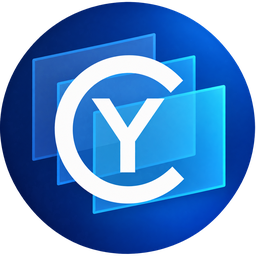
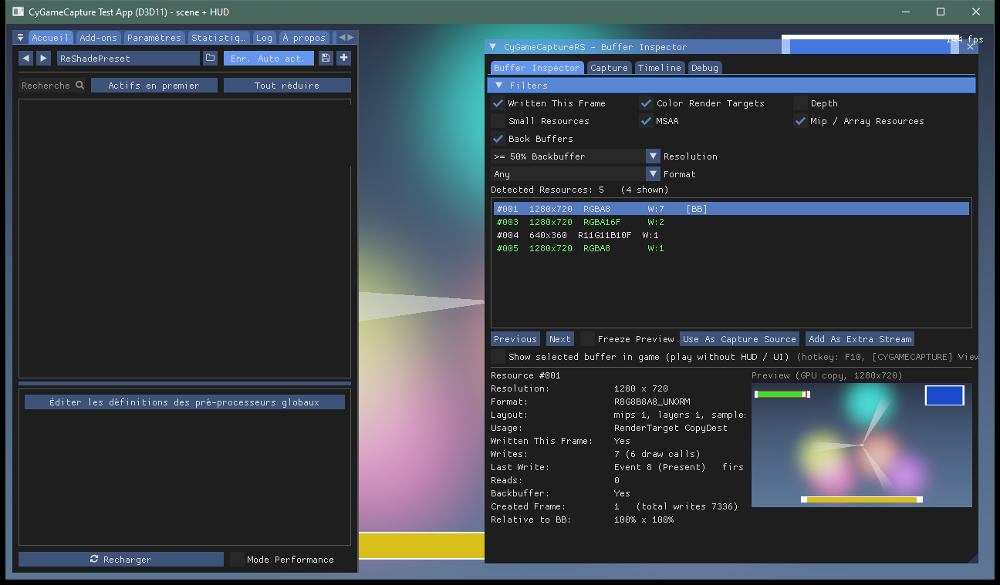
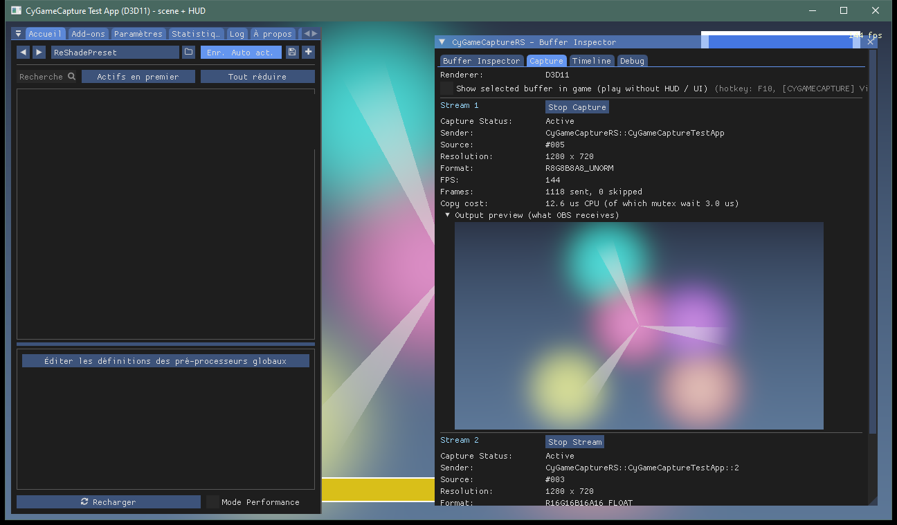
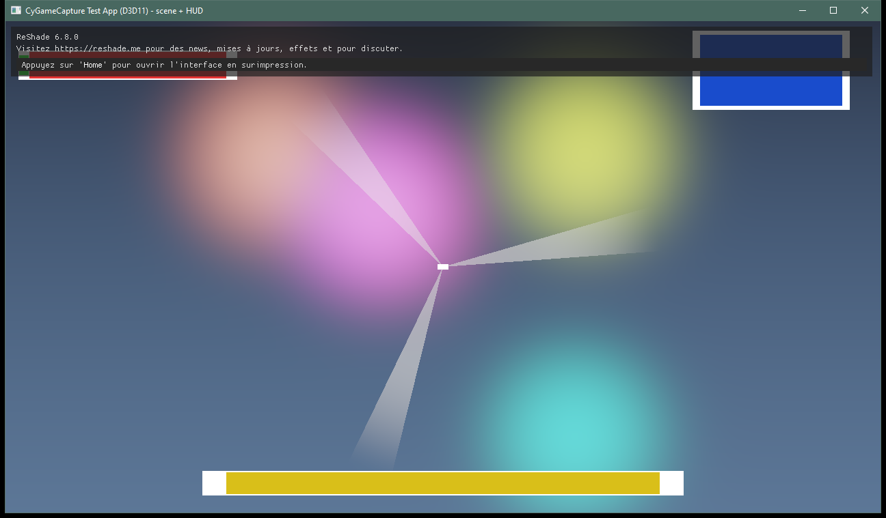
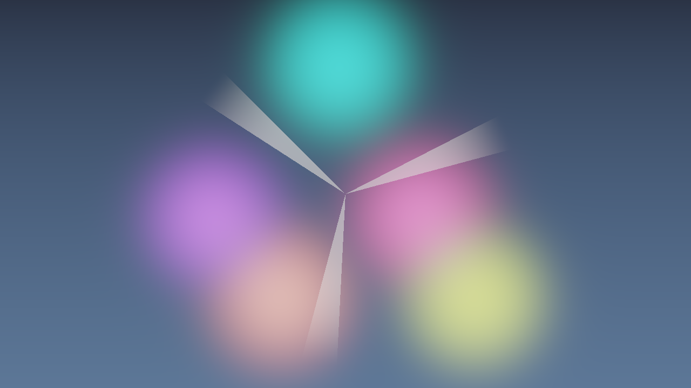

<table width="100%">
  <tr>
    <td width="300" align="left" valign="top">
      <a href="https://mrmybal.github.io/CyGameCapture/Documentation.html#/en/overview">Documentation</a><br>
      <a href="https://github.com/MrMybal/CyGameCapture">Source repository</a><br>
      <a href="https://github.com/MrMybal/CyGameCapture/issues">Issue tracker</a><br><br>
      <sub>README</sub><br>
      <a href="README.md">English</a> · <a href="README.fr.md">Français</a>
    </td>
    <td width="400" align="center" valign="middle">
      
    </td>
    <td width="300" align="right" valign="top">
      <p><sub>Application licenses</sub><br><a href="LICENSE"><strong>AGPL-3.0-or-later</strong></a><br><a href="CyGameCaptureUE/LICENSE">Unreal plugin: MIT</a></p>
      <p><sub>Version</sub><br><a href="CHANGELOG.md#current-version"><strong>0.1.0</strong></a><br><strong>BETA</strong></p>
      <p><a href="https://github.com/MrMybal/CyGameCapture/releases/download/v0.1.0/CyGameCapture-0.1.0-Complete-Win64.zip"><strong>Download</strong></a><br><sub>Windows x64</sub></p>
    </td>
  </tr>
</table>

<h1 align="center">CyGameCapture</h1>
<p align="center">By <a href="https://github.com/MrMybal">Cyberalien</a></p>

Capture the image you need from a game's rendering pipeline and share it with OBS or another Spout2 application. CyGameCapture combines a ReShade buffer inspector, an OBS source plugin and an Unreal Engine sender/receiver plugin for streamers and developers working with game images.

> **BETA · 0.1.0**
>
> Available for testing and validation before a stable release. Check the [version notes, fixes and known limitations](CHANGELOG.md#current-version) before updating. The current downloads include the documentation update published on November 6, 2026.

[](Docs/Images/m1_buffer_inspector.png)

## The application

Keep the normal game image, including its HUD and menus, while sending a clean scene to OBS. Choose a render target in the **Buffer Inspector**, check its preview and click **Use As Capture Source**. If the game draws its HUD straight into the final image, D3D11 capture can select a moment before the HUD is drawn.

```text
Game → ReShade → selected buffer → shared GPU texture → Spout2 → OBS
```

The **Capture** tab shows each stream's sender name, resolution, frame counters and output preview. Add extra streams for other buffers, a linearised depth image or an isolated HUD. In OBS, add a **CyGameCapture** source and select the matching sender. Recording several streams into separate files is also available.

[](Docs/Images/m1_capture_tab_two_streams.png)

| Player view with HUD | Clean scene received through Spout |
| --- | --- |
| [](Docs/Images/m1_player_view_with_hud.png) | [](Docs/Images/m1_spout_receiver_clean_scene.png) |

These are actual captures of the animated test application, taken at different moments.

The Unreal plugin publishes render targets, scene captures or the game viewport, and receives Spout textures into Unreal materials. It exposes Blueprint and C++ APIs and can run independently of ReShade or OBS.

## Features

- **Inspect buffers:** contact sheet, resource filters, formats, write events, steadiness and GPU previews.
- **Share several images:** Spout2 colour streams, derived depth and isolated HUD; D3D11 and D3D12 capture backends.
- **Choose a frame moment:** D3D11 capture after a selected write, before the game adds its interface.
- **Play with the selected image:** **F10** toggles a compatible selected buffer in game; capture remains a separate action.
- **Optional AI assistance:** on D3D11, an installed and signed-in Claude Code, Codex or OpenCode client can propose a buffer and capture moment. You inspect and apply the proposal yourself. The chosen provider receives sampled images, buffer metadata and the conversation through your account; manual capture needs no AI client.
- **Unreal workflows:** multiple senders and receivers, render targets, scene captures and viewport sources on Win64 D3D11/D3D12.
- **English/French help:** 37 fully translated pages with search, images, annotations, comparisons and SVG diagrams. Open **User guide** in ReShade or OBS, **Help → CyGameCapture user guide** in Unreal, or press **F1** while the ReShade inspector is focused.

---

## Installation

### Requirements and downloads

Use **Windows 10/11 x64** and a 64-bit game in which ReShade is allowed. D3D11 and D3D12 are the tested capture backends; D3D10 support is limited. Intermediate frame moments and AI buffer search require D3D11. This pipeline does not support Vulkan or OpenGL and does not bypass anti-cheat restrictions.

[Download the complete 0.1.0 package](https://github.com/MrMybal/CyGameCapture/releases/download/v0.1.0/CyGameCapture-0.1.0-Complete-Win64.zip), or choose the ReShade, OBS or matching Unreal package on the [release page](https://github.com/MrMybal/CyGameCapture/releases/tag/v0.1.0). Prebuilt Unreal Editor plugins cover **5.3, 5.4, 5.5, 5.6, 5.7 and 5.8**; source compatibility targets 4.27–5.8, with 4.27 and cooked Shipping targets still unverified. Check downloads against the release's [SHA256SUMS.txt](https://github.com/MrMybal/CyGameCapture/releases/download/v0.1.0/SHA256SUMS.txt).

### ReShade and OBS

1. Install **ReShade 6.8.0 with add-on support** for the game. The add-on targets API 20; the plain ReShade build cannot load it.
2. Extract the entire package. Copy `CyGameCaptureRS.addon64`, `CyGameCaptureAI.exe`, `Documentation` and the supplied licenses together next to the game executable, or into the configured ReShade add-on directory.
3. Open ReShade with **Home**, select a suitable buffer and click **Use As Capture Source**. Check the output preview in **Capture**. A stream normally appears as `CyGameCaptureRS::<Game>`.
4. For the native OBS receiver, use **64-bit OBS Studio 29.1 or later**; the plugin is built against 29.1.3. Close OBS and run `Install-OBS-Plugin.cmd` from the fully extracted OBS package. Restart OBS, then choose **Sources → + → CyGameCapture** and select the sender. An existing generic Spout2 receiver can also receive the stream.

Use the same GPU for the game and OBS. If a complete scene becomes transparent or invisible, leave **Preserve source alpha** off for colour streams; derived HUD streams keep their mask. See the [first-capture walkthrough](https://mrmybal.github.io/CyGameCapture/Documentation.html#/en/quickstart) and [troubleshooting](https://mrmybal.github.io/CyGameCapture/Documentation.html#/en/troubleshooting).

### Unreal Engine

Extract the package for your engine version into `<Project>/Plugins/CyGameCaptureUE`, enable it and restart the editor. Select D3D11 or D3D12, add a **CyGameCapture Spout Sender** component and assign a render target or scene capture. Enter Play and choose the published sender in your receiver. Follow the [Unreal quickstart](https://mrmybal.github.io/CyGameCapture/Documentation.html#/en/ue-getting-started) for viewport capture, receiving and Blueprint usage.

### Local manual and updates

Open [Documentation/Documentation.html](Documentation/Documentation.html#/en/overview) from the extracted application or plugin folder. Keep the complete `Documentation` directory: the reader, images, scripts and both languages work through `file://`, without a server, CDN, Internet connection or Node.js installation. OBS installs its copy with the plugin's data.

Close the game, OBS and Unreal before replacing loaded components. Replace binaries, the helper, documentation and license files together. Preserve `ReShade.ini`, OBS settings and scene collections; do not overwrite them with the test application's example configuration. Keep an older package for rollback.

## Source, build and required libraries

<details>
<summary>Build CyGameCapture and prepare local packages</summary>

### Requirements

- Windows x64, **Visual Studio 2022** with MSVC v143 and the C++/CMake/Ninja tools; **CMake 3.21+** and C++17.
- **Node.js 22+ and npm**, for generating the documentation during builds. The pinned local CyDoc archive is included; no registry substitute is needed.
- An installed OBS Studio for generating the optional OBS/FFmpeg import libraries; a matching Unreal Engine installation for Unreal plugin builds.
- The native dependencies are included as the limited SDK/header subsets described in the license table. ReShade, OBS, Unreal and AI provider clients are installed separately.

### Get the source and build

```bat
git clone https://github.com/MrMybal/CyGameCapture.git
cd CyGameCapture
npm --prefix .CyDocBuild ci
Tools\GenerateObsImportLib.cmd
build.cmd Release
```

`GenerateObsImportLib.cmd` reads the installed OBS `obs.dll`. Without its generated import library, CMake skips the OBS plugin and builds the other components. Optional `Tools\GenerateFFmpegImportLibs.cmd` enables the video probe using FFmpeg DLLs already installed with OBS.

Outputs in `bin\Release` include the ReShade add-on and AI helper, `obs-plugins\64bit\CyGameCaptureOBS.dll`, its `data\obs-plugins\CyGameCaptureOBS` folder, test applications and receiver tools. To run the D3D11 test, install the ReShade add-on build's `dxgi.dll` beside `bin\Release\TestApp\CyGameCaptureTestApp.exe`, then launch that executable.

### Packages and diagnostics

```bat
Tools\MakeTestPackage.cmd
Tools\MakeRelease.cmd
```

The test folder is assembled in `dist\CyGameCapture_Test`. Use `Tools\MakeTestPackage.cmd noue` to omit Unreal packages. Release archives are written to `dist\CyGameCapture-0.1.0` with the complete manual, notices and checksums. Unreal packages must first exist in `build\Plugin_UE<version>`; see the [Unreal build instructions](CyGameCaptureUE/README.md#verified).

While a sender is running, these optional tools list streams, save received frames and inspect a recording:

```bat
bin\Release\CyGameCaptureSpoutReceiverTest.exe --list
bin\Release\CyGameCaptureSpoutReceiverTest.exe --frames 3 --out "%TEMP%"
bin\Release\CyGameCaptureVideoProbe.exe "take.mkv" 2
```

See the [configuration reference](https://mrmybal.github.io/CyGameCapture/Documentation.html#/en/configuration), [recording guide](https://mrmybal.github.io/CyGameCapture/Documentation.html#/en/recording) and [public API](https://mrmybal.github.io/CyGameCapture/Documentation.html#/en/api-links) for settings, precision limits and integration examples.

</details>

---

## License

**CyGameCaptureRS, CyGameCaptureAI, CyGameCaptureCore and CyGameCaptureOBS use [AGPL-3.0-or-later](LICENSE). The Unreal plugin uses [MIT](CyGameCaptureUE/LICENSE).** Copyright © 2026 Cyberalien. These licenses do not replace the terms of third-party components. The Unreal plugin does not link the AGPL application components.

### Native libraries and the reader

| Library · source | License · terms | Use / scope |
| --- | --- | --- |
| [ReShade add-on SDK 6.8.0 · API 20](https://github.com/crosire/reshade/tree/18deaa52de0c425a78b329e9cb3c497281cd00ec) | [BSD-3-Clause OR MIT](CyGameCaptureRS/ThirdParty/THIRD_PARTY_NOTICES.md) | Headers for the native ReShade integration; ReShade itself is installed separately. |
| [Dear ImGui 1.92.5](https://github.com/ocornut/imgui/tree/3912b3d9a9c1b3f17431aebafd86d2f40ee6e59c) | [MIT](LICENCES/DearImGui-MIT.txt) | Overlay headers; ReShade supplies the ImGui function table at runtime. |
| [Spout2 DirectX subset](https://github.com/leadedge/Spout2/tree/c2bcc12147711d12ace7d5f08e869d774d840f8a) | [BSD-2-Clause and supplied notices](LICENCES/Spout2-LICENSE.txt) | Compiled native texture sharing for the producers, receiver and tools. |
| [OBS Studio / libobs 29.1.3](https://github.com/obsproject/obs-studio/tree/29.1.3) | [GPL-2.0-or-later; cooperation commitment](CyGameCaptureOBS/ThirdParty/THIRD_PARTY_NOTICES.md) | Public headers and user-installed libobs for the optional OBS plugin; import library generated locally. |
| [FFmpeg 6.0 headers](https://github.com/FFmpeg/FFmpeg/tree/n6.0) | [LGPL-2.1-or-later and build terms](Tests/CyGameCaptureVideoProbe/ThirdParty/THIRD_PARTY_NOTICES.md) | Optional video probe only; dynamically loads the user's OBS FFmpeg libraries. No FFmpeg DLL is bundled. |
| [CyDoc 0.1.0 · revision 6ddf9a5](https://github.com/MrMybal/CyDoc/tree/6ddf9a582defb2f11fbb3f992afef6f98dcadc93) | [MIT](.CyDocBuild/vendor/LICENSE.txt) | Local documentation reader and image module; generation tools run at build time. Source access may require permission. No Three.js or mesh module is included. |
| [Unreal Engine](https://www.unrealengine.com/) | [Epic's Unreal Engine terms](https://www.unrealengine.com/eula/unreal) | Separately installed host/runtime and build toolchain for the MIT Unreal plugin. The engine is not redistributed here. |

### Documentation build and development tools

| Library · source | License · terms | Use / scope |
| --- | --- | --- |
| [marked 17.0.6](https://github.com/markedjs/marked/tree/v17.0.6) | [MIT](https://github.com/markedjs/marked/blob/v17.0.6/LICENSE.md) | Build-time Markdown compilation through CyDoc. |
| [PrismJS 1.30.0](https://github.com/PrismJS/prism/tree/v1.30.0) | [MIT](https://github.com/PrismJS/prism/blob/v1.30.0/LICENSE) | Build-time code highlighting. |
| [esbuild 0.25.12](https://github.com/evanw/esbuild/tree/v0.25.12) | [MIT](https://github.com/evanw/esbuild/blob/v0.25.12/LICENSE.md) | Documentation export bundling. |
| [Playwright 1.62.1](https://github.com/microsoft/playwright/tree/v1.62.1) | [Apache-2.0](https://github.com/microsoft/playwright/blob/v1.62.1/LICENSE) | Development/CI reader tests with an installed browser; not shipped to users. |
| [Node.js](https://github.com/nodejs/node) | [MIT and component notices](https://github.com/nodejs/node/blob/main/LICENSE) | Build-time runtime only; not required to read the manual. |

This table is an index, not a replacement for complete notices. Preserve the supplied `LICENCES` folders and [source references](LICENCES/SOURCES.txt). The product's native **CyGameCaptureCore** is distinct from CyToolsCore; this application includes neither CyToolsCore nor CyUEMCPSDK, nor a Python assistant runtime. AI clients remain optional, separately installed software under their providers' terms.

## References and links

- [English documentation](https://mrmybal.github.io/CyGameCapture/Documentation.html#/en/overview) · [Documentation en français](https://mrmybal.github.io/CyGameCapture/Documentation.html#/fr/overview).
- [Changes and known limitations](CHANGELOG.md#current-version) · [Releases](https://github.com/MrMybal/CyGameCapture/releases) · [Issue tracker](https://github.com/MrMybal/CyGameCapture/issues).
- [Source repository](https://github.com/MrMybal/CyGameCapture) · [OBS plugin](CyGameCaptureOBS/README.md) · [Unreal plugin](CyGameCaptureUE/README.md).
